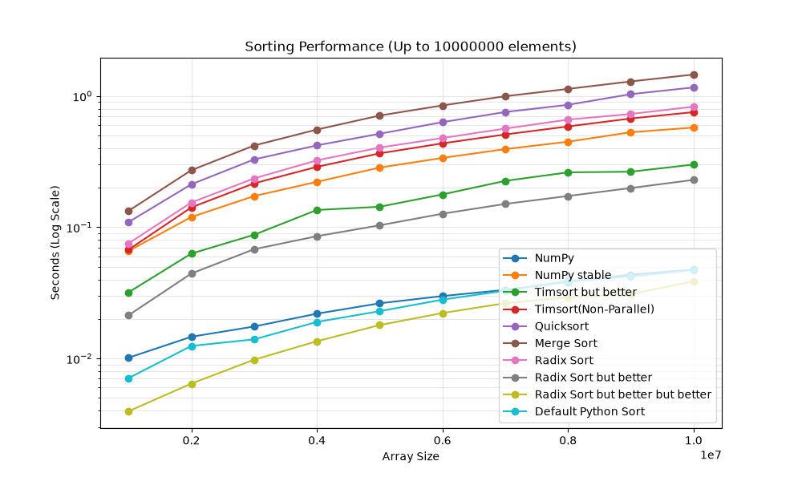
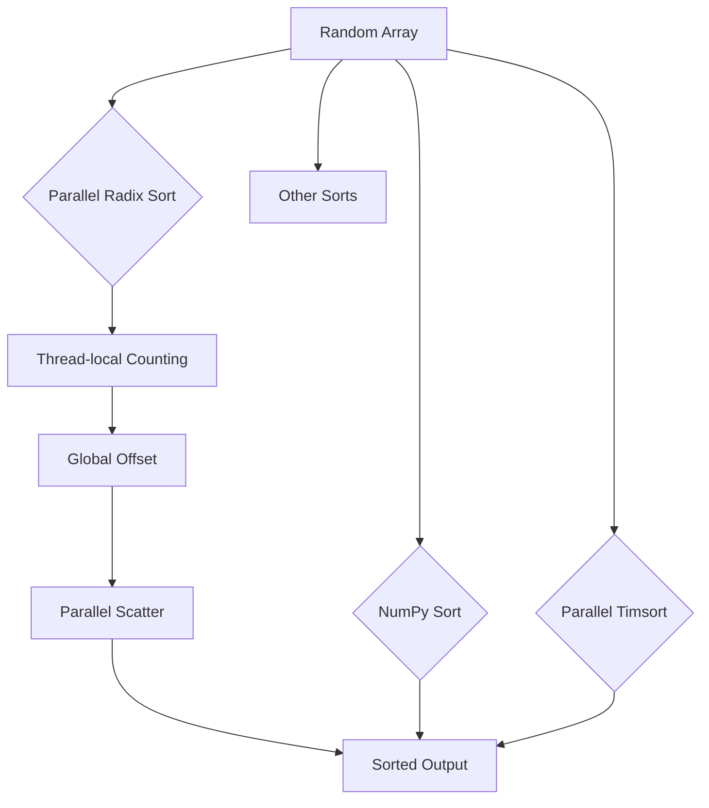

# ⚡ Sorting Performance Benchmarking with Numba

> **High-performance sorting algorithm comparison using Numba JIT compilation and parallel computing.**

[](https://python.org)
[](https://numba.pydata.org)
[](https://numpy.org)

---

## 📌 Overview

This project implements and benchmarks **9 sorting algorithms** — from classic textbook sorts to highly optimized parallel variants — all accelerated via **Numba's JIT compilation**. The benchmarking engine measures execution time across array sizes from **1 million to 10 million elements** and visualizes the results.

The standout performer is the **Parallel Radix Sort (Base-256)**, which leverages bitwise operations and multi-threaded counting to significantly outperform even NumPy's native `np.sort`.

---

## 🧠 Implemented Algorithms

| Algorithm | Variant | Parallel | Notes |
|---|---|---|---|
| **Insertion Sort** | Classic | ❌ | Used internally by bucket sort |
| **Quicksort** | Hoare-style (Numpy-filter) | ❌ | Elegant but stack-heavy |
| **Merge Sort** | Top-down | ❌ | Classic divide & conquer |
| **Radix Sort** | LSD Base-10 | ❌ | Counting sort per digit |
| **Radix Sort (Parallel)** | LSD Base-10 | ✅ | Thread-local counting + scatter |
| **Radix Sort (Optimized)** | LSD **Base-256** | ✅ | Bitwise ops, ping-pong buffers |
| **Timsort** | Adaptive merge | ❌ | Python's built-in strategy |
| **Timsort (Parallel)** | Adaptive merge | ✅ | Parallelized merges |
| **Bucket Sort** | sqrt(N) buckets | ✅ | Insertion-sort per bucket |
| **NumPy sort** | Introselect | ✅ | C-level parallel (baseline) |
| **Python `list.sort`** | Timsort | ❌ | CPython built-in (baseline) |

---

## 📊 Benchmark Results



*Performance comparison of sorting algorithms across increasing array sizes (log scale on Y-axis).*

### Key Findings

- **Parallel Radix Sort (Base-256)** dominates across all sizes, outperforming NumPy's highly optimized `np.sort` due to **O(n)** pass complexity and efficient bitwise digit extraction.
- **Parallel Timsort** shows strong gains over its serial counterpart, confirming that merge phases are embarrassingly parallel.
- **Quicksort** and **Merge Sort** degrade at large scales due to recursion overhead and lack of parallelization.
- **Memory-bandwidth-bound** algorithms (bucket sort) plateau despite parallelism.

> **Note:** All benchmarks run with warm-up iterations to exclude JIT compilation time.

---

## 🚀 Getting Started

### Prerequisites

```bash
pip install numba numpy matplotlib
```

### Run the Benchmark

```bash
python sorting_numba.py
```

This will:
1. JIT-compile all sorting functions (warm-up phase)
2. Benchmark each algorithm on arrays from 1M to 10M elements
3. Print a results table for the largest size
4. Display an interactive performance plot

### Customize

Edit the `sizes` list in `sorting_numba.py` to change the range of tested array sizes:

```python
sizes = list(range(1_000_000, 10_000_001, 1_000_000))
```

To benchmark a single large array (e.g., 100M elements), swap in:

```python
sizes = [100_000_000]
```

---

## 🔧 Architecture



### Code Structure

```
sorting_numba.py
├── Sorting Implementations
│   ├── insertion_sort()         # Serial baseline
│   ├── bucket_sort()            # Parallel buckets
│   ├── quicksort()              # Serial recursive
│   ├── merge_sort()             # Serial recursive
│   ├── radix_sort()             # LSD Base-10 serial
│   ├── parallel_radix_sort()    # LSD Base-10 parallel
│   ├── parallel_radix_sort_optimized()  # LSD Base-256 ping-pong
│   ├── parallel_timsort()       # Parallel merge phases
│   └── non_parallel_timsort()   # Serial control
├── Benchmarking Engine
│   ├── run_benchmarks()
│   └── Plotting (matplotlib)
└── Main Entry Point
```

### Parallel Radix Sort (Base-256) — The Star

The optimized radix sort works in 3 stages per digit pass:

1. **Parallel Local Counting** — Each thread counts digits in its chunk using fast `>>` and `&` bitwise ops (Base-256 → 256 buckets instead of 10).
2. **Global Offset Calculation** — Serial prefix sum of counts to determine write positions.
3. **Parallel Scatter** — Each thread writes values directly to correct positions in the ping-pong buffer.

Ping-pong buffers (`buffer1` ↔ `buffer2`) eliminate per-pass allocations, and Base-256 reduces the number of passes by 2.5× vs Base-10.

---

## 📈 Performance Characteristics

| Algorithm | Time Complexity | Space | Parallel | Best For |
|---|---|---|---|---|
| Parallel Radix (Base-256) | **O(n)** | O(n) | ✅ | Large int arrays |
| NumPy sort | **O(n log n)** | O(n) | ✅ | General-purpose |
| Parallel Timsort | **O(n log n)** | O(n) | ✅ | Nearly-sorted data |
| Quicksort | **O(n²)** worst | O(log n) | ❌ | Small arrays |
| Merge Sort | **O(n log n)** | O(n) | ❌ | Stable sort req. |

---

## 🛠️ Requirements

| Package | Minimum Version |
|---|---|
| Python | 3.8 |
| numba | 0.60 |
| numpy | 1.24 |
| matplotlib | 3.6 |

---

## 📄 License

This project is open source and available under the [MIT License](LICENSE).

---

## 🤝 Contributing

Contributions are welcome! If you'd like to add a new sorting variant (e.g., GPU-accelerated via CUDA, hyper-threaded samplesort), feel free to open a PR or issue.
